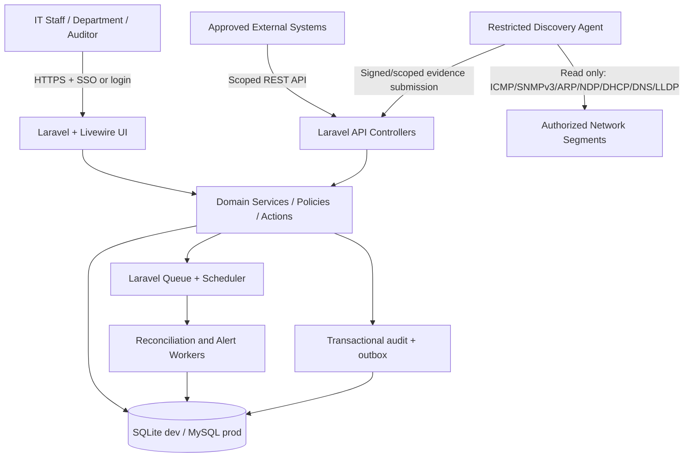
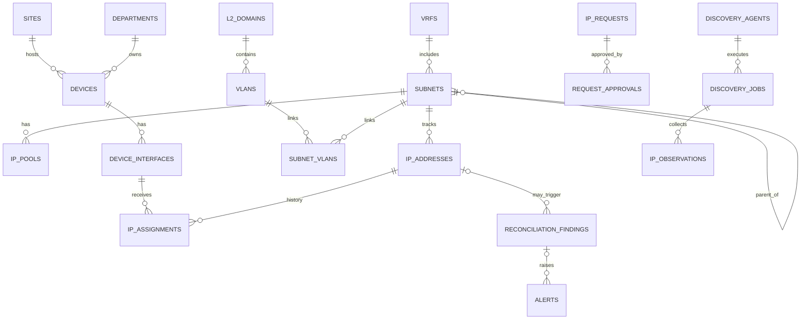
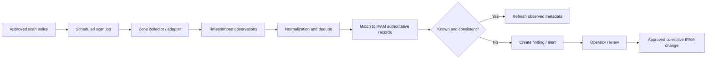
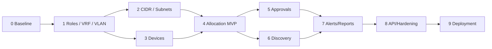

# KYAMCH Smart Network & IP Address Management (IPAM)
## Enterprise Development Master Plan / Product Requirements / Technical Architecture

> **Document ID:** KYAMCH-IPAM-001  
> **Version:** 1.0.0  
> **Status:** Implementation baseline; discovery-dependent integrations require site verification  
> **Prepared:** 2026-11-22  
> **Intended repository path:** `docs/NETWORK_IPAM_ENTERPRISE_DEVELOPMENT_PLAN.md`  
> **Primary technology:** Laravel 13, PHP 8.3+, Livewire 4, Blade, Tailwind CSS 4, Vite  
> **Development database:** SQLite  
> **Production database:** MySQL 8.0+ (InnoDB; select supported vendor/minor version during deployment design)  
> **Deployment model:** Internal/on-premises HTTPS application; permitted discovery agents in managed network zones  
> **System owner:** KYAMCH IT / Network Operations (to be assigned)  
> **Data classification:** Internal / sensitive infrastructure information; restrict access accordingly

---

## 0. Instructions to implementation agents and developers

This is the **single authoritative implementation plan** for the custom enterprise IPAM software. Read it completely before changing the codebase.

1. **Inspect first:** Determine whether the repository is empty or already contains Laravel, packages, migrations, code, or tests. Preserve existing functioning code. Never overwrite unrelated work.
2. **Do not invent operational facts:** Network ranges, VLAN IDs, server IPs, credentials, equipment inventory, and clinical device scanning permissions are **unknown**. Examples in this document are fictional and must not be used in production.
3. **Build in stages:** Complete prerequisites, implement one coherent vertical slice, run its relevant tests, and publish evidence before continuing. Use the work breakdown in section 22.
4. **Database parity is mandatory:** SQLite is for local development, MySQL is for production. Important write-concurrency, FK/index and query behavior must be integration-tested on MySQL before release.
5. **Safety and least privilege:** Never scan production IPs, connect to network hardware, modify DNS/DHCP, or execute production migrations without written operator authorization and an explicit configured target scope.
6. **Source of truth vs observations:** IPAM allocation records are authoritative; pings, DHCP, ARP, NDP, DNS, SNMP and LLDP are evidence, not automatic authorization to release or reassign addresses.
7. **No fake completeness:** If hardware integration, MySQL, browser automation, or credentials are not available, implement a testable adapter, record a blocker, and clearly label the capability unverified. Do not fabricate successful execution.
8. **Definition of done:** Each stage needs migrations, validation, policies, transaction-safe services where relevant, UI, automated tests, documentation, and updated traceability checklist.
9. **Security:** All backend authorization, input validation, and audit logging must be enforced server-side. A hidden button is not access control.
10. **Change governance:** Architectural decisions are recorded in `docs/adr/`. Changes to the rules here must be explicit and traceable.

### 0.1 Development decision log — baseline

| Topic | Baseline decision |
|---|---|
| Product | Single-organization, multi-site enterprise IPAM; site-scope and VRF-aware |
| Architecture | Laravel modular monolith + separately scheduled/isolated discovery workers |
| UI | Blade + Livewire 4 + Tailwind CSS 4, responsive accessible ERP-style interface |
| API | Versioned JSON REST endpoints for authorized integrations |
| DB | SQLite development; MySQL InnoDB production; portable migrations/domain logic |
| Address families | IPv4 and IPv6 first-class from the initial schema |
| Keys | Internal BIGINT IDs; use UUID/ULID public identifiers where external exposure warrants it |
| Time | Store UTC timestamps; show local time by per-user preference, default `Asia/Dhaka` |
| Status | Allocation state independent from observed connectivity; historical records never silently destroyed |
| Allocation | Atomic database-enforced uniqueness; locks + conflict-aware retry on MySQL |
| Monitoring | Safe opt-in, segmented; no aggressive medical-network probing |
| Network writes | **Out of scope for MVP**; later require approval, dry-run, retry and rollback design |
| Deploy | Private HTTPS, role-based access, backups, worker supervision, monitoring and audit |

---

## 1. Vision, measurable goals and boundaries

### 1.1 Vision

Provide one centrally managed, trustworthy map of network address space and associated assets across hospital departments, sites and network segments. IT staff must be able to answer **who owns an IP, where it belongs, what it connects to, and whether it is eligible for allocation**, with evidence and history.

### 1.2 Business goals

- Eliminate conflicting manual spreadsheets and inconsistent allocation logs.
- Support nested parent/child IPv4/IPv6 CIDR plans, VRF boundaries and VLAN mapping.
- Find candidate free IPs while preserving reserved, DHCP-owned, quarantined and assigned addresses.
- Associate each address with device interfaces, owners, departments, physical locations and lifecycle.
- Discover observed devices through **authorized, low-impact** integration/collection.
- Reconcile documented vs observed usage; flag mismatches without destructively auto-changing ownership.
- Deliver searchable inventory, standardized approvals, usage forecasts, reports and immutable audit history.
- Operate reliably when some network integrations are offline or unavailable.

### 1.3 Success metrics (pilot targets, to be approved)

| KPI | Initial acceptance target |
|---|---|
| Duplicate active assignment | 0 in concurrency test suite and pilot |
| Unauthorized IP release by offline result | 0 |
| Record audit coverage | 100% of core create/update/assign/release/approve transitions |
| User permission isolation | 100% of scripted denial scenarios pass |
| Subnet list/search | P95 < 2 seconds on agreed pilot dataset/hardware |
| Typical address assignment | P95 < 3 seconds excluding external approval or integration |
| Dashboard | P95 < 3 seconds with cached/pre-aggregated counts where necessary |
| Scheduled job reliability | Retryable, observable, and idempotent |
| Recovery readiness | Restore drill completed before live go/no-go |

These are **engineering targets**, not measured production performance. Establish baseline volumes and infrastructure before setting binding SLOs.

### 1.4 In scope

IPAM, CIDR planning, subnet hierarchy, VRFs, VLAN/L2 domains, sites/locations/departments, address ranges, static/DHCP responsibility, requests/approvals, device/interface inventory, network connections, read-only evidence collection, event reconciliation, alerts, reporting/export, RBAC, auditing, API and operations.

### 1.5 Explicit non-goals for first production release

- Acting as a DHCP/DNS server or authoritative router/firewall configuration controller.
- Intrusive vulnerability scanning, port sweeps, credential attacks or clinical device interrogation.
- Full traffic analytics, SIEM, packet capture, NMS performance telemetry or network access control.
- Automatic reconfiguration of production switches, DNS, DHCP or firewalls.
- Blindly treating ICMP reachability as proof of address ownership.
- Multitenant SaaS billing; single organization with strong site/VRF scoping is sufficient.

---

## 2. Stakeholders, roles and permissions

### 2.1 Personas

1. **Platform Super Admin:** users, roles, global settings, API and infrastructure integrations.
2. **Network Admin:** address space, VRFs/VLANs, devices, assignments, scan policies, reconciliations.
3. **IP Operator:** create IP requests/allocations within assigned scope, manage permitted device records.
4. **Department Operator:** view department-owned resources and initiate allocation/release requests.
5. **Auditor:** read permitted reports, change trails and reconciliation evidence; no state edits.
6. **Viewer:** search permitted records only.
7. **Service Account/Agent:** short-scoped machine identity for approved read or evidence ingestion API.
8. **Approver:** authorization for specified critical actions, independent of originating requester.

### 2.2 RBAC and object scope

- Laravel Policies/Gates enforce per-action authorization; model policies must check **organization/site/VRF/subnet/department scopes** and role capabilities.
- Roles and permissions should be persisted (e.g., a **verified Laravel-13-compatible** permissions package or equivalent custom policies). Do not introduce a package without checking compatibility and security maintenance.
- Policies cover **viewAny/view/create/update/delete/retire/assign/release/scan/approve/export/import** separately.
- Sensitive fields (discovery credentials, SNMP metadata, secret tokens) must never appear in generic serialization, CSV, logs, or unauthorized detail views.
- Two-person approval for configurable critical operations; requester cannot approve their own request where separation-of-duty is required.
- Service identities have revocable tokens, expirations, source restrictions where feasible, and minimal scopes.

### 2.3 Permission matrix (baseline)

| Action | Super | Net Admin | Operator | Department | Auditor | Viewer | Agent |
|---|---|---|---|---|---|---|---|
| Configure global settings | Y | N | N | N | N | N | N |
| Manage VRF/VLAN/subnets | Y | Y | Limited by policy | N | Read | Read scoped | N |
| View IP/device inventory | Y | Y | Scoped | Department scoped | Scoped | Scoped | Minimal API |
| Assign/reserve/release IP | Y | Y | Scoped | Request only | N | N | N |
| Approve critical changes | Authorized independent approver | As delegated | As delegated | N | N | N | N |
| Schedule network discovery | Y | Approved scope | N | N | N | N | N |
| Submit discovery observations | N | N | N | N | N | N | Strict ingestion only |
| View audit history | Y | Scoped | Own relevant | Own relevant | Scoped | N | N |
| Manage users/tokens | Y | N | N | N | N | N | N |

Implement granular permission rows, not merely string comparisons to role names.

---

## 3. Domain glossary and business invariants

### 3.1 Domain terms

- **VRF / routing domain:** context in which an IP prefix and address must be unique. Different VRFs may intentionally reuse the same IP.
- **L2 domain:** namespace for VLAN IDs and broadcast domains; the same VLAN ID may occur at different sites or isolated switching fabrics.
- **Prefix/Subnet:** normalized CIDR; may be aggregate (non-allocating) or assignment-enabled (leaf, subject to policy).
- **IP Range/Pool:** an interval within a prefix, classified as static pool, DHCP-managed pool, exclusion, reservation group or other policy region.
- **Address record:** authoritative allocation/status metadata for a specific IP within a routing context; untracked free addresses need not exist as database rows.
- **Assignment:** time-bounded relationship between an address and a device interface, with history.
- **Observation:** timestamped evidence from a source, including validity and source metadata; not equivalent to an assignment.
- **Allocation candidate:** currently not administratively allocated/excluded, possibly eligible subject to policy and evidence.
- **Connectivity:** online/offline/unknown/stale observation status, distinct from allocation state.

### 3.2 Non-negotiable invariants

1. `(vrf_id, address_family, canonical_ip_hex)` identifies **one authoritative IP record**. Use an explicit default VRF row; never rely on nullable unique keys.
2. `(vrf_id, address_family, canonical_network_hex, prefix_length)` identifies one canonical prefix.
3. CIDR canonicalization: host bits zeroed on prefix creation; IPv4 and IPv6 handled separately.
4. A child prefix must be wholly contained in its parent; a parent chain must be acyclic.
5. Two prefixes in the **same VRF and address family** may overlap only when one is a proper ancestor of the other in the recorded hierarchy; overlapping siblings/partially overlapping prefixes prohibited. Same CIDR duplicate prohibited.
6. Assignment-enabled prefix must not double-allocate addresses delegated to child prefixes. MVP default: **allocate only from assignment-enabled leaves**. To split an occupied prefix, first resolve affected assignments through an approved migration workflow.
7. An IP cannot be simultaneously assigned to two ordinary current interfaces. Explicit documented exceptions (e.g., VIP/shared virtual identity) require separate data model and approval; never silently allow duplicate owners.
8. `allocation_status` never changes to available purely because a scan failed, a device was offline, or evidence expired.
9. DHCP leases are observed state. DHCP pool ownership is administrative. A static assignment must not overlap an authoritative dynamic pool unless an approved reservation/exclusion operation exists.
10. Every assignment, release and transfer must be atomic, authenticated, authorized, timestamped and auditable.
11. A released address remains quarantined until configurable validation/hold requirements are met.
12. Prefix capacity excludes relevant non-allocatable addresses according to prefix type/family. IPv4 ordinary subnet network/broadcast rules do **not** apply indiscriminately to IPv4 `/31` or `/32`; IPv6 has its own rules.
13. No code may enumerate, instantiate or store every possible address of a very large IPv4 or IPv6 prefix.
14. Device != IP: a device has 0..N interfaces and interfaces have 0..N addresses over time.
15. Physical devices may be offline for long intervals (notably medical equipment); offline never implies available.
16. `last_seen_at` is source-specific; stale information must be visibly labeled.
17. Historical information is not hard deleted through ordinary UI paths. Use lifecycle retirement and audited restoration.

### 3.3 Lifecycle models

**Prefix:** `planned -> active -> deprecated -> retired`; retirement blocked while active child prefixes/assignments exist unless an approved migration handles them.

**Device:** `planned -> active -> maintenance -> retired`; `missing/unreachable` is observation state, not lifecycle.

**Address allocation:** `candidate (virtual) -> reserved | assigned | blocked`; `assigned -> quarantine -> eligible candidate` after release review; allow approved state changes with explicit reason and audit.

**IP request:** `draft -> submitted -> pending_approval -> approved | rejected -> provisioning -> completed | failed | cancelled`; reject inappropriate transitions; keep reasons and approver.

**Discovery job:** `queued -> running -> succeeded | partial | failed | cancelled`, with bounded retries and visible failure cause.

**Alert:** `open -> acknowledged -> investigating -> resolved | suppressed`, with escalation and dedupe.

---

## 4. Application architecture

### 4.1 Logical context



### 4.2 Architecture style

**Modular monolith**, not premature microservices. Use thin controllers/Livewire components; put domain logic in actions/services and dedicated validators. Read-only network collection runs out of HTTP requests and through independently supervised queue/agent processes.

Proposed bounded contexts:

- `IdentityAndAccess` — users, roles, scopes, MFA, service tokens.
- `Organization` — sites, buildings, rooms, racks, departments.
- `AddressSpace` — VRFs, prefixes, subnet hierarchy, capacity and IP pools.
- `Layer2` — VLANs, L2 domains, links and interfaces.
- `Inventory` — devices, types, asset associations and interfaces.
- `Allocation` — addresses, requests, reservations, assignments, state machine.
- `Discovery` — agents, scan policies, jobs, evidence and reconciliation.
- `Operations` — alerts, approvals, change requests, reports, exports and audit.
- `Integrations` — DHCP, DNS, network equipment, external asset systems and tokens.

### 4.3 Suggested repository layout

```text
app/
  Actions/{AddressSpace,Allocation,Inventory,Discovery}/
  Domain/{AddressSpace,Allocation,Inventory,Discovery,Security}/
    DTOs/ Exceptions/ Enums/ Policies/ ValueObjects/
  Http/Controllers/Api/V1/
  Http/Requests/
  Livewire/
    Dashboard/ Subnets/ IPAddresses/ Devices/ VLANs/ VRFs/
    Discovery/ Requests/ Alerts/ Reports/ Admin/
  Models/
  Policies/
  Jobs/{Discovery,Reconciliation,Notifications}/
  Services/{IPMath,Allocation,Discovery,Integrations,Reporting}/
  Console/Commands/
  Support/{Audit,Idempotency,Pagination}/
bootstrap/
config/{ipam.php,discovery.php,security.php}
database/{migrations,factories,seeders}
docs/
  NETWORK_IPAM_ENTERPRISE_DEVELOPMENT_PLAN.md
  adr/ api/ runbooks/ diagrams/ releases/
resources/{views,css,js}
routes/{web.php,api.php,console.php}
tests/{Unit,Feature,Integration,Architecture,Fixtures}
.github/workflows/  # optional: equivalent CI supported
GEMINI.md
```

Avoid creating empty layers/files merely to match layout. Add them when their domain capability is implemented.

### 4.4 Coding standards

- PSR-12, strict typing where practical, type declarations, enums for finite states and small immutable value objects for IP/CIDR.
- No business decisions inside Blade templates, raw SQL in Livewire actions, or authentication checks only in views.
- Favor Eloquent for CRUD, query builder for justified bulk/reporting paths; make query performance observable.
- Centralized translations (`lang/en`, optionally `lang/bn`), semantic UI and consistent reusable form/table components.
- Explicit DTOs for discovery ingestion and API boundaries. Do not mass assign externally supplied foreign keys without policy checks.
- ADRs for risky changes and concise README/runbooks.

---

## 5. Technology compatibility and setup

### 5.1 Baseline versions

Use the **current supported stable minor within the agreed majors**, constrained by compatibility and project lock files:

- PHP 8.3+ (use a version supported by Laravel 13 and production OS).
- Laravel 13.x.
- Livewire 4.x (class-based full-page components are acceptable; do not blindly use removed Livewire 3 APIs).
- Tailwind CSS 4.x via `@tailwindcss/vite` and Vite.
- Composer and Node.js LTS compatible with installed packages.
- SQLite for local/dev, MySQL 8.0+ InnoDB for staging/production.
- Testing: Laravel built-in PHPUnit or Pest, choose one consistently and document it; Livewire component tests and browser E2E via a maintainable runner.

Use latest **stable compatible** package versions only after checking their official docs. Freeze versions in lock files. Do not paste unverified framework-specific commands without checking actual project version.

### 5.2 Environment separation

`local`: SQLite, fake/fixture discovery adapters, mail log, queue database or sync for specific tests, safe sample data only.

`testing-sqlite`: SQLite in-memory/file tests for fast unit/feature coverage.

`testing-mysql`: dedicated ephemeral MySQL test DB for locking, uniqueness, foreign keys, isolation, collation, and MySQL-only behavior; never point tests at production.

`staging`: MySQL, production-like queue/scheduler, synthetic or explicitly permitted anonymized data, test integrations.

`production`: MySQL, HTTPS, least-privilege DB account, supervised workers, monitoring, backups, no demo fixtures, no manual development servers.

### 5.3 SQLite -> MySQL portability rules

- Use Laravel Schema Builder and portable column types; avoid SQLite-only SQL and avoid MySQL-only stored procedure dependencies in core domain logic.
- Set SQLite foreign keys **ON**. Unit tests must not hide referential integrity issues.
- Validate canonical addressing, prefix overlap and state transitions in PHP services; persist indexed normalized columns.
- SQLite does **not** offer production-equivalent row-level `SELECT ... FOR UPDATE`; production assignments must be tested with multiple simultaneous MySQL connections.
- Prefer ASCII lowercase fixed-width IP hex keys for deterministic sort/compare across engines; use MySQL binary collation or explicitly compatible collation/index strategy for these technical columns.
- Never rely on `NULL` inside composite `UNIQUE` constraints for VRF identity. Use a non-null default VRF ID.
- Use `unique` indexes and catch duplicate-key errors even with application prechecks; prechecks alone race.
- Avoid MySQL-specific JSON query syntax in core features. For JSON payloads use portable string/JSON storage and typed accessors, with tested differences.
- Do not assume equal behavior for booleans, case-insensitive collations, date arithmetic, `GROUP BY`, schema constraints, upserts or generated columns.
- Test migrations **from an empty database**, schema rollback where safe, imports, and release-build migration sequencing on both engines.
- All meaningful state-changing operations must be idempotent or have an idempotency key/command ID.

### 5.4 Core local environment example

```dotenv
APP_NAME="KYAMCH Smart IPAM"
APP_ENV=local
APP_DEBUG=true
APP_URL=http://localhost:8000
APP_TIMEZONE=UTC
DB_CONNECTION=sqlite
DB_DATABASE=/absolute/path/to/project/database/database.sqlite
QUEUE_CONNECTION=database
CACHE_STORE=database
SESSION_DRIVER=database
IPAM_DISCOVERY_ENABLED=false
IPAM_DISCOVERY_ALLOW_LIVE_TARGETS=false
IPAM_EXTERNAL_WRITES_ENABLED=false
```

Production sketch **(do not paste credentials into repo)**:

```dotenv
APP_ENV=production
APP_DEBUG=false
APP_URL=https://internal-ipam.example.invalid
DB_CONNECTION=mysql
DB_HOST=<approved-db-host>
DB_PORT=3306
DB_DATABASE=<approved-database>
DB_USERNAME=<secret-manager-or-provisioned-user>
DB_PASSWORD=<load-securely>
QUEUE_CONNECTION=database
IPAM_DISCOVERY_ENABLED=false
IPAM_EXTERNAL_WRITES_ENABLED=false
```

`.env` is not committed. Install/release scripts must fail fast when production configuration is missing. Use secret storage or protected environment variables for secrets, encrypted config for credentials where supported; never echo them.

---

## 6. IP address math, canonicalization and scale

### 6.1 Canonical IP representation

Create a tested `IpAddress` and `IpPrefix` value-object library.

1. Parse addresses with robust IPv4/IPv6 validators / `inet_pton` (never regular-expression-only parsing).
2. Normalize IP display using `inet_ntop`; normalize CIDR to network base address and validated prefix length.
3. Store `ip_version` = 4 or 6.
4. Store `address_hex` as **lowercase fixed-length hex per address family**: IPv4 = 8 characters, IPv6 = 32 characters.
5. For prefixes, store `network_hex`, `first_hex`, `last_hex`, all same family-specific width; `prefix_length`; canonical `cidr` display.
6. Hex ordering is lexicographically equivalent to unsigned network-order numeric ordering **only within the same family and fixed width**. Always filter by VRF and family before range checks.
7. Use `brick/math` BigInteger or an equivalent verified 128-bit-capable implementation for capacity, offsets and pagination. Do not rely on PHP native 64-bit integer for IPv6 arithmetic.
8. Canonicalize IPv4-mapped IPv6 according to a documented, consistent policy; do not silently treat as ordinary IPv4 unless specifically approved.
9. Store decimal capacity values as strings or derive them on demand. For IPv6, show capacity in scientific/compact form rather than overflowing counters.

### 6.2 CIDR operations

Required and unit-tested:

- `parseIp`, `parseCidr`, `networkOf`, `first`, `last`, `containsIp`, `containsPrefix`.
- `overlapsPrefix`, `adjacent`, `splitPrefix`, `aggregatePrefixes`, `subtractChildPrefix`, `nextAddress`, `addressAtOffset`.
- `usableHostPolicy` for IPv4 ordinary, `/31`, `/32`, IPv6 gateway/subnet-router anycast policy as applicable.
- `findFreeSubnetWithinParent`, `findCandidateIp`, subnet utilization calculations, and gap-list pagination.
- `belongsToVrF` validation driven by DB data rather than string naming.

### 6.3 Scale and rendering

- Never call `range()` for large prefixes or seed millions of IP rows.
- For IP explorer, use seek/cursor pagination over a generated address **window** and sparse materialized records.
- Avoid forcing a full /64 IPv6 address grid. Provide search/filter, prefix navigation and assigned/reserved address list instead.
- Show virtual candidates only within bounded windows, clearly distinguish virtual candidate from formally validated allocation.
- Capacity is computed per non-overlapping pool and from authoritative statuses; never sum parent and child prefixes as independent capacity.
- Use caching/pre-aggregation where needed, invalidate on authoritative changes.
- Search/index by `(vrf_id, ip_version, address_hex)`, prefix containment bounds, device ID, MAC, VLAN, site and hostname.

### 6.4 Critical test vectors

- IPv4 `/24`, `/30`, `/31`, `/32`, low/high boundaries, parent/child containment, partial overlap, canonical host-bit normalization.
- IPv6 `/64`, `/127`, `/128`, compressed notation, full 128-bit boundaries, very large sizes without overflow.
- IPv4 mapped IPv6 parsing; invalid prefix length; whitespace/leading zeros; case normalization.
- Search in separate VRFs with identical IP and subnet; same VRF duplicate fails.
- Network and broadcast exclusions where applicable, plus explicit administrative exclusions.

---

## 7. Functional modules and acceptance contracts

The following module IDs provide stable traceability. All CRUD screens require permission checks, request validation, audit, safe delete/retirement, search/filter, pagination and accessible empty/error/loading states.

### M01 — Organization & location masters (P0)

**Entities:** organization settings, site/campus, building, floor, room, rack, department, department owner/contact, tags.

**Features:** hierarchical location tree, unique scoped codes, active/inactive, department contacts, import/export, address association, ownership transfers. Devices may have physical location and logical ownership separately.

**Acceptance:** records cannot be retired with unresolved critical dependencies unless migration approved; users can filter inventory by site/department.

### M02 — VRF/routing contexts (P0)

**Features:** mandatory default VRF, add/edit/retire VRFs, RD/route-target fields optional (no assumptions), site association, purpose, authorized scope, duplicate-prefix/address policy across VRFs, VRF-level capacity.

**Acceptance:** same IP may exist in two VRFs; never permitted twice as ordinary current address in one VRF.

### M03 — L2 domains, VLANs and segments (P0)

**Features:** VLAN ID (1–4094 subject to standards/reserved policy), name, L2 namespace/site, purpose, security zone, active status, gateways/SVIs, attached prefixes, trunk/access ports when discovery supports. Uniqueness `(l2_domain_id, vlan_id)`.

**Acceptance:** VLAN ID reuse across different L2 domains is allowed; duplicated ID within one L2 domain is rejected.

### M04 — Subnet/prefix management (P0)

**Fields:** name, description, canonical CIDR, family, VRF, parent, prefix type (`aggregate`, `assignable`, `point_to_point`, `loopback`), site, owner, associated VLAN(s), lifecycle, gateway/interface linkage, DNS/DHCP references, alert threshold, notes, tags, monitoring opt-in and audit.

**Features:** expandable hierarchy, add main/child, prefix calculator, subnet split with preview, free child-prefix suggestions, route context, conflict preview, merge/deprecate with controlled migration, subnet utilization, ancestry/breadcrumb, aggregate detail, bulk CSV import with dry run.

**Acceptance:** child fully contained, no overlapping siblings or cycles, uniqueness by VRF/family, no assignments silently orphaned by split/move/retirement, aggregate parents not double counted.

### M05 — Address pools and exclusions (P0)

**Pool types:** `static_pool`, `dhcp_pool`, `infrastructure_reserved`, `excluded`, `quarantine_pool`, `temporary_pool` (exact meanings configurable but non-overlapping ownership rules enforced).

**Fields:** prefix, start/end, pool type, priority, allocation strategy, default hold/quarantine, DHCP server/scope reference, gateway/DNS exceptions, owner, status.

**Features:** interval visualization, overlap validation, candidate selection bounds, DHCP-aware exclusion, per-pool utilization.

**Acceptance:** pool must fit prefix, prohibited conflicting overlaps rejected, DHCP dynamic addresses never offered as static candidates without approved coordination.

### M06 — Device and interface inventory (P0)

**Device fields:** code, hostname, display name, category, role, asset tag, site, department, room/rack, owner, model, manufacturer, serial, OS/firmware, environment, criticality, notes, active lifecycle, discovery identity links.

**Interface fields:** device ID, interface name/index, `physical | virtual | loopback | management`, MAC (optional, normalized), VLAN tag, speed/status observation, parent NIC, switch port connection, labels; multiple IP assignments over time.

**Features:** multi-NIC, multi-IP, devices without IP, physical/virtual groups, attachments with type/size policy, asset cross-reference, device timeline, controlled merge for duplicate discovered inventory.

**Acceptance:** device identity is independent of IP; historical interfaces/assignments remain traceable after transfers.

### M07 — IP address explorer & records (P0)

**Fields:** VRF, subnet, family, canonical IP, allocation status, classification (`gateway`, `VIP`, `loopback`, `management`, `regular`, etc.), authoritative description, site/department from ownership, DNS name, last reconciled date, admin notes.

**Features:** subnet-scoped address list, allocation and observation badges **separately**, search by exact IP/CIDR/hostname/MAC/device, candidate-window generator, IP details panel, grouping by pool, bulk filters, export, history.

**Acceptance:** offline assigned IP remains unavailable; no unbounded address-grid generation; IP unique per VRF.

### M08 — Smart allocation, reservations, releases (P0)

**Modes:** manual requested-IP assignment, automatic first-free within pool, reserve for future, transfer, bulk assignment, static/DHCP reservation request, quarantine and block/unblock with reasons.

**Features:** single use-case service called by both Livewire/API; candidate validation; compare against records, pool policy and recent conflict evidence; deterministic lock/retry; assignment to device interface; expiration/quarantine; audit/notifications; limited preapproved VIP exceptions later.

**Acceptance:** two parallel allocators cannot succeed for same VRF/IP; failed transactions leave no phantom ownership; duplicates caught by DB index.

### M09 — Approval and change workflow (P1)

**Features:** requests for assignment, subnet creation/split, release, critical IP transfer, DHCP reservation and policy exception. Per-action approval matrix, separation of duties, SLA, comments, attachments, request timeline, cancellation/rejection reason, self-approval rules.

**Acceptance:** only approved requests can trigger approval-required changes; replays cannot provision twice.

### M10 — Safe discovery & observation ingestion (P1)

**Agent inventory:** agent ID, site/zone, identity, allowed CIDRs/VRFs, protocol allowlist, rate limits, maintenance window, enablement, heartbeat, last error, credential reference.

**Ingestion sources:** ICMP, allowed local ARP/NDP neighbors, SNMPv3, LLDP/CDP when permitted, DHCP leases, DNS and device inventory integrations.

**Features:** explicit opt-in per subnet, scan jobs, schedule, cancellation, retries, dry-run adapter, bounded ingestion, dedupe, observation timestamps, source/confidence, attachment to provisional device identity, retention and error reporting.

**Acceptance:** fake fixture scans cannot mutate allocations; no scan to unauthorized CIDRs; clinical VLAN excluded by default; unknown identity raises review record.

### M11 — Reconciliation and conflicts (P1)

**Features:** compare authoritative IP ownership vs recent observations, detect `unknown_active_ip`, `unexpected_mac`, `reported_duplicate_ip`, `dns_mismatch`, `dhcp_conflict`, `stale_assignment`, `subnet_exhaustion`, `agent_down` and evidence conflict. Score/label evidence and handle false positives/exceptions.

**Acceptance:** observation updates only observational records; critical mismatches require review; a silent device never becomes automatically free.

### M12 — Alerting and notifications (P1)

**Features:** severity, rule, signature/dedupe, asset references, event history, acknowledgement, assignment, suppression, maintenance windows, email/in-app notification, escalation, retention.

**Acceptance:** repeated same event does not flood users; resolved incidents preserve forensic trail.

### M13 — Dashboard, reporting and exports (P1)

**Dashboards:** managed VRFs/subnets, tracked/allocated/reserved/candidate capacity, stale/unknown observations, conflicts, approvals, top utilized segments, recent changes, agent health. Always label metric scope and snapshot age.

**Reports:** subnet hierarchy, utilization, address ownership, devices by department/site, VLAN/VRF, unmanaged IP, conflict, DHCP/DNS reconciliation, stale records, allocation history, audit, export. Export large datasets through authorized queued jobs, temporary signed downloads and expiration.

**Acceptance:** scope-filtered reports show only authorized records; no secret leakage; parent totals don't double-count child space.

### M14 — Integrations and API (P1/P2)

**Read-oriented adapters:** DHCP lease/scope imports, DNS A/AAAA/PTR, SNMPv3 device/neighbor metadata, optional asset/CMDB synchronization, SSO/LDAP when approved. Health checks, sync history, idempotent change detection, record source attribution.

**Write back (P2 only):** approved DNS/DHCP reservation tasks with plan/dry run, dual authorization for critical changes, idempotency, reconciliation, rollback/manual recovery and detailed logs. Must be disabled by default.

**API:** `/api/v1` authenticated and scoped; pagination, query limits, validation, standardized errors, stable IDs, idempotency tokens for writes, rate limits and audit.

### M15 — Security, operations and system administration (P0/P1)

Users, role assignments, scoped permissions, account lockout, MFA where appropriate, session/SSO configuration, secrets reference, audit browse, import/export history, feature flags, system health, queue/disk/agent status, backup/restore runbooks, data retention, notifications and UI preferences.

---

## 8. UX / information architecture

### 8.1 Primary navigation

1. Dashboard: overview, events, capacity, approvals.
2. Address Space: prefix hierarchy, subnet explorer, subnet planner/calculator, VRFs, pools.
3. Network Segmentation: VLANs, L2 domains, zones, routed interfaces.
4. IP Addresses: global search, subnet IP grid, reservations, assignment history.
5. Devices & Assets: devices, interfaces, connections, locations, department assignment.
6. Requests: new request, pending approvals, history.
7. Discovery & Reconciliation: agents, policies, scans, results, unmatched evidence, conflicts.
8. Alerts & Monitoring: events, exceptions, notification settings.
9. Reports: utilization, ownership, audit, exports.
10. Administration: users, roles, scope, integrations, lookups, policy settings, job health.

### 8.2 UI standards

- Professional hospital enterprise theme; compact but readable, accessible contrast, responsive navigation; light/dark optional.
- Subnet tree + split panel + large paginated IP grid; breadcrumb for current site/VRF/prefix.
- IPv4/IPv6 CIDRs displayed monospace; range and VRF always visible in the context bar.
- Allocation state and connectivity state shown as **different labeled columns**; do not rely on color alone.
- Clear empty states, loading and stale-evidence warnings; destructive actions require confirmation and reason.
- Debounced search, server pagination, persistent filters, safe copy-to-clipboard, keyboard controls.
- Bulk operations require preview counts and conflict listing before commit.
- Dates displayed in user timezone, default Asia/Dhaka, but all stored audit timestamps UTC.
- Do not place sensitive SNMP strings, API tokens, DB credentials, or IPAM agent secrets in browser HTML, JS or error screens.

### 8.3 Mock interaction: allocate IP

From subnet detail, click `Allocate IP` -> select device/interface or register new device -> choose static pool -> show candidate with VRF/VLAN and evidence status -> confirm authorized reason/approval -> execute atomic transaction -> show assignment and audit receipt. If candidate conflicts, show precise conflict and offer a new candidate, never automatically override it.

---

## 9. Detailed conceptual data model

Naming uses lower snake_case. Add standard `id`, timestamps, created/updated actor references and appropriate lifecycle columns where required. The descriptions below are contracts; implementation migrations must specify nullability, indexed fields, unique keys, foreign keys and cascading behavior explicitly.

### 9.1 Organization and identity tables

| Table | Core columns | Keys / special rules |
|---|---|---|
| `organizations` | `name`, `slug`, `status` | Seed one organization; do not assume multi-tenant SaaS |
| `sites` | `organization_id`, `code`, `name`, `timezone`, `status` | Unique org/code |
| `locations` | `site_id`, `parent_id`, `type`, `code`, `name` | Tree, no cycles; unique under scoped parent |
| `departments` | `organization_id`, `code`, `name`, `owner_user_id`, `status` | Unique org/code |
| `users` | normal Laravel user fields, `status`, MFA/SSO metadata | Never store plaintext credentials |
| `roles`, `permissions`, `role_permissions`, `user_roles` | permission/role grants and optional scope | Add scoped access pivot where needed |
| `user_scopes` | `user_id`, `scope_type`, `scope_id`, `permission_set` | Explicit scoped grants; application-level validation |
| `tags`, `taggables` | tag text, type, morph association | Avoid unbounded arbitrary privileged tagging |
| `settings` | namespaced key, value, sensitive flag | Secrets referenced securely, not plain stored values |

### 9.2 Address space tables

| Table | Core columns | Keys / special rules |
|---|---|---|
| `vrfs` | `code`, `name`, `description`, optional routing ID, `status` | Non-null default VRF row; unique code |
| `l2_domains` | `site_id`, `code`, `name`, `status` | Unique site/code |
| `vlans` | `l2_domain_id`, `vlan_id`, `name`, `security_zone`, `status` | Unique `(l2_domain_id,vlan_id)` |
| `subnets` | `vrf_id`, `parent_id`, `site_id`, `name`, `cidr`, `ip_version`, `network_hex`, `start_hex`, `end_hex`, `prefix_length`, `subnet_type`, `status`, `allocation_enabled`, `department_id`, `scan_enabled` | Unique `(vrf_id,ip_version,network_hex,prefix_length)`; parent containment and ancestry validation |
| `subnet_vlans` | `subnet_id`, `vlan_id`, `association_type`, `gateway_interface_id` | Unique scoped relationship; configurable 1-to-many only where valid |
| `ip_pools` | `subnet_id`, `name`, `start_hex`, `end_hex`, `type`, `allocation_strategy`, `status`, `priority` | Validate contained interval and pool overlap policy |
| `ip_addresses` | `vrf_id`, `subnet_id`, `ip_version`, `address_hex`, `address_text`, `allocation_status`, `classification`, `current_assignment_id`, `description` | **Unique `(vrf_id,ip_version,address_hex)`**; current association consistent with assignment |
| `ip_reservations` | `ip_address_id`, `reserved_for_device_id`, `reason`, `starts_at`, `expires_at`, `status` | Prevent competing active reservations |
| `ip_exclusions` | `subnet_id`, optional range/IP, `reason`, `status` | Can be modeled as pool type; avoid duplicate contradictory sources |

### 9.3 Devices and assignment tables

| Table | Core columns | Keys / special rules |
|---|---|---|
| `device_types` | `code`, `name`, `category`, `status` | Configurable types |
| `manufacturers` | `name`, `website`, `status` | Optional master |
| `device_models` | `manufacturer_id`, `device_type_id`, `model`, `status` | Optional master |
| `devices` | `device_type_id`, `hostname`, `name`, `asset_tag`, `serial_number`, `site_id`, `location_id`, `department_id`, `owner_user_id`, `criticality`, `lifecycle`, `monitoring_policy_id` | No dependence on IP; scoped uniqueness for asset_tag where specified |
| `device_interfaces` | `device_id`, `name`, `if_index`, `mac_address`, `type`, `parent_interface_id`, `status`, `vlan_id` | Unique interface within device; MAC may be duplicate for legitimate virtual/cluster cases |
| `interface_links` | `from_interface_id`, `to_interface_id`, `link_type`, `valid_from`, `valid_to`, `source` | Historical topology connections |
| `ip_assignments` | `ip_address_id`, `interface_id`, `assigned_at`, `released_at`, `assignment_method`, `assigned_by`, `release_reason`, `request_id` | History; enforce one current ordinary assignment through IP row locking/pointer and service invariants |
| `device_documents` | `device_id`, `file_path`, `media_type`, `uploaded_by`, `classification` | Private storage and virus/type controls |

**Important MySQL design note:** A unique index on `(ip_address_id, released_at)` does **not** ensure only one active assignment, because multiple `NULL` values may be allowed. Make `ip_addresses` the authoritative current ownership row, update it inside a lock/transaction, and store historical assignments in `ip_assignments`. Use a unique `ip_addresses.current_assignment_id` when a pointer exists, validate pointer belongs to same address, and test under concurrent MySQL connections. If more complex multi-active VIP models are needed later, model them separately.

### 9.4 Workflows, discovery, evidence and operations

| Table | Core columns | Rules |
|---|---|---|
| `ip_requests` | `requester_id`, `request_type`, `target_type`, `target_id`, `payload_json`, `status`, `reason`, `idempotency_key` | Stable transition workflow, unique request key where applicable |
| `request_approvals` | `request_id`, `approver_id`, `decision`, `reason`, `decided_at` | Independent approval policy |
| `change_records` | `request_id`, `actor_id`, `change_type`, `before_json`, `after_json`, `result`, `correlation_id` | Auditable change intent/result |
| `discovery_agents` | `site_id`, `code`, `identity_ref`, `enabled`, `last_seen_at`, `last_error` | No plaintext secrets |
| `discovery_policies` | `site_id`, `agent_id`, `allowed_subnet_id`, `protocols_json`, `rate_limit`, `maintenance_window`, `enabled` | Scope/policy restrictions |
| `discovery_jobs` | `agent_id`, `policy_id`, `requested_by`, `status`, `started_at`, `finished_at`, `metrics_json`, `error_summary` | Cancellation/partial failure visible |
| `ip_observations` | `discovery_job_id`, `vrf_id`, `address_hex`, `ip_version`, `observed_mac`, `hostname`, `interface_ref`, `source_type`, `observed_at`, `confidence`, `payload_ref` | May be unmatched; append evidence rather than change ownership |
| `device_observations` | `device_id` optional, `device_identity`, `source`, `observed_at`, `payload_json` | Differentiate observed vs authoritative |
| `dhcp_scopes` | `integration_id`, `subnet_id`, `start_hex`, `end_hex`, `external_id`, `last_synced_at` | Source-qualified import |
| `dhcp_leases` | `dhcp_scope_id`, `ip_version`, `address_hex`, `mac`, `client_id`, `lease_start`, `lease_end`, `observed_at` | Lease evidence, not permanent ownership |
| `dns_records` | `integration_id`, `zone`, `name`, `type`, `record_value`, `ttl`, `last_synced_at` | Controlled read-only import at first |
| `reconciliation_findings` | `finding_type`, `vrf_id`, `ip_address_id` nullable, `observed_identity`, `evidence_refs`, `status`, `severity` | Reviewable mismatch |
| `alerts` | `finding_id` optional, `rule_code`, `dedupe_key`, `severity`, `status`, `assignee_id`, `opened_at`, `resolved_at` | Dedupe, acknowledgements |
| `notification_deliveries` | `alert_id`, `channel`, `recipient_id`, `attempts`, `result` | Async retry and rate limit |
| `integrations` | `type`, `name`, `site_id`, `config_json`, `credential_ref`, `enabled`, `last_success_at` | No secret raw response in logs |
| `integration_runs` | `integration_id`, `status`, `started_at`, `ended_at`, `summary_json` | Idempotent sync and errors |
| `audit_events` | `actor_type`, `actor_id`, `event_type`, `subject_type`, `subject_id`, `before_json`, `after_json`, `reason`, `request_id`, `created_at` | Append-only authorization and privacy filters |
| `outbox_events` | `event_id`, `event_type`, `payload_json`, `published_at`, `attempts`, `status` | Commit with domain transaction |
| `export_jobs` | `requested_by`, `type`, `filters_json`, `status`, `private_file_path`, `expires_at` | Permission-scoped, expiring outputs |
| `api_tokens` | Laravel-compatible token fields, scoped permissions and expiry | Revoke/rotate |

### 9.5 High-level ERD



### 9.6 Foreign-key behavior

- Never cascade-delete assignment or audit history when an IP/device/subnet is removed from active use.
- `restrict` deletes on parent entities with active dependents. Use retire and subsequent approved archive workflow.
- Timestamps and actor IDs must be inserted consistently; audit event in same DB transaction as the authoritative change.
- `subnets.parent_id` and `locations.parent_id` must be validated against self-reference and cycles in service code.
- Keep `organization_id` for future data partitioning only where it improves policy and consistency; avoid inconsistent redundant foreign keys.

---

## 10. Transactional IP allocation — design and pseudocode

### 10.1 Requested/automatic allocation service

Inputs: authenticated actor, permitted VRF, subnet/pool, requested IP or selection policy, device interface, purpose, request/approval ID if applicable, idempotency key.

Validation must check: permitted actor/scope, subnet active/assignable, address family, pool membership, child delegated areas, gateway/exclusions, dynamic DHCP pool, existing assignment/reservation, quarantine/blocked states, conflicting recent evidence, and required approvals.

**Do not trust a UI-presented candidate at commit time.** Recheck under transaction.

```text
allocateIp(command):
  authorize(command.actor, "ip.assign", command.scope)
  validateRequestShapeAndOwnership(command)
  if alreadyCompleted(command.idempotencyKey): return storedReceipt

  for boundedRetry in 1..N:
    choose candidate using prefix/pool policies (NOT a ping-only result)
    begin DB transaction
      lock relevant address row if it exists (MySQL SELECT FOR UPDATE)
      if not exists:
         insert unique (vrf_id, ip_version, address_hex) claim row
         # unique index is decisive if two operators race
      re-read and validate authoritative status, pool and evidence/policy
      recheck approvals and idempotency
      append ip_assignments row
      set ip_addresses.current_assignment_id and allocation_status='assigned'
      write audit event, idempotency receipt, outbox event
    commit
    return allocation receipt
  catch unique/lock/deadlock conflict:
    rollback and retry with fresh candidate, bounded and with jitter
  fail with a clear conflict/retry-safe error, never double-assign
```

**SQLite note:** row-level locking is not equivalent to MySQL. Fast SQLite tests verify behavior and DB uniqueness, but a dedicated MySQL multi-process test must prove correctness under concurrent requests.

### 10.2 Release and quarantine

```text
releaseIp(command):
  authorize + verify approved owner/request
  transactional lock of IP current state
  record release reason/time on active assignment
  clear current assignment pointer
  mark quarantine with policy expiry, not available
  persist audit/outbox
  after commit: queue DNS/DHCP discrepancy check and reconciliation
  only after quarantine expiry and relevant checks:
     re-evaluate and mark eligible candidate, or keep blocked for review
```

### 10.3 Transfer IP

Transfer is a single transaction: lock current IP record, close old assignment, add new assignment, update current pointer, audit both sides and reconcile integrations. Never release into public candidate pool between steps.

### 10.4 Reserve IP

Reservation checks active/current assignment and excludes the IP from automatic candidate selection; reservation may reference intended device/department/expiry. Reservation expiry is a workflow event subject to verification, not unreviewed instant allocation.

### 10.5 Split/merge subnet

Use dry-run preview listing affected child prefixes, pools, IP records and active assignments. Confirm the split does not orphan data; require explicit migration mapping and approval for occupied space. Execute atomically where DB workload permits, otherwise controlled migration job with non-overlapping steps and rollback checkpoints.

---

## 11. Discovery agent and observation safety design

### 11.1 Collection modes

- **Fixture-only adapter:** mandatory for development/tests; generates safe fake evidence.
- **Read-only DHCP/DNS integration:** retrieves configured data through approved APIs/files/accounts.
- **Network-device telemetry:** SNMPv3 read-only, interface, ARP/NDP and LLDP tables from trusted network devices.
- **Authorized ICMP checks:** optional, rate-limited, limited to approved destinations.
- **Host-side agent:** optional when authorized for OS/interface metadata.

Use separate **adapter interfaces** for each type. Laravel queues schedule commands; a zone-local worker/agent may be implemented as a restricted PHP CLI process or separate supported collector service. The required user stack remains Laravel/Livewire/Tailwind/SQLite/MySQL; do not add Python/Node network daemons unless justified and approved.

### 11.2 Non-negotiable safety guardrails

1. Default global switch `IPAM_DISCOVERY_ENABLED=false` in all new installs.
2. Allowlist target CIDRs/site/VRF per agent; deny all other targets regardless of UI input.
3. Clinical device networks excluded by default and subject to formal approval and nonintrusive policy.
4. Read-only protocols and credentials; SNMPv3 authentication/encryption when possible; prohibit SNMP community secrets in public logs.
5. Rate/concurrency/timeout bounds, per-run duration, daily job quota, maintenance windows and emergency stop.
6. Strict SSRF protection: remote user cannot control a URL or IP for arbitrary server-side probes. Validate scope at the agent boundary, not only in Laravel UI.
7. Never build shell commands with unsanitized user input; use vetted libraries/process argument arrays and avoid shell interpolation.
8. Network discovery is opt-in; stop on network/operator request. Prohibit vulnerability scans and port scanning in the product unless separately authorized/spec'd.
9. Store timestamps, agent, method, source device and confidence/evidence; mark stale observations.
10. Agent ingestion uses authenticated, scoped identity, replay protection, bounded payload size and deduplication.

### 11.3 Scan and reconciliation DFD



### 11.4 Observation semantics

- One lack-of-ping result should never mark a device definitively offline. Use configured consecutive failures, evidence source and last successful observation.
- `offline` only indicates a specific monitored device/source failed its reachability threshold.
- `stale` indicates evidence aged past freshness SLA; do not blend with `available`.
- Detect duplicate-IP evidence cautiously; MAC movement may reflect VRRP/HSRP/cluster failover, virtualization or NAT. Provide exception/virtual-IP classification.
- Cache/aggregate readings but keep source evidence for investigation with retention policy.

---

## 12. Search, dashboards and reports

### 12.1 Indexed global search

Allow exact IP, CIDR containment, VRF, VLAN ID+domain, hostname, MAC, device ID/asset tag, serial, department, site/building/room, ownership, status and tags. Search results must show enough context (VRF/site) to distinguish duplicate private IPs across routing domains.

### 12.2 Dashboard metric formulas

- `Assigned`: distinct current authoritative addresses with allocation_status=`assigned`, excluding duplicate parent calculations.
- `Reserved`: authoritative reservations or reserved pool individual allocations as defined.
- `Blocked/Quarantined`: distinct non-allocatable addresses and intervals according to pool rules.
- `Static pool free candidates`: pool capacity minus assigned/reserved/blocked/excluded/quarantined address space and child delegations; **does not guarantee no unknown live device**.
- `Observed online`: recently confirmed by applicable monitoring policy, not a count of assignable addresses.
- Parent/child: count distinct address space at the configured leaf/pool level; never sum overlapping aggregate prefixes.
- All dashboard counts should display `calculated_at` or data freshness if pre-aggregated.

### 12.3 Reports and exports

Reports include subnet tree/capacity, available CIDR gaps, VLAN/VRF mapping, assigned/reserved pools, devices by department/site/criticality, stale records, active DHCP leases versus authoritative assignments, DNS mismatches, conflicts, approvals and audits. Apply authorization filters in backend queries. Export CSV/Excel/PDF where libraries are compatible; Excel exports should escape formula-injection prefixes and cap volume through queued jobs. Secure downloads should expire.

---

## 13. Integration contracts and API design

### 13.1 API standards

- Prefix `/api/v1`; Laravel REST resource controllers/use-case services; OpenAPI specification maintained in `docs/api/openapi.yaml` when API is introduced.
- Auth: scoped token or organization SSO gateway, rate limiting, audit, secure CORS; **no** admin browser session reused by discovery agents.
- JSON uses stable public IDs, display CIDR/IP strings, explicit VRF context, ISO 8601 timestamps, clear error envelope and pagination cursor.
- State changes use idempotency key; conditionally use optimistic version check to prevent overwrite.
- Do not expose raw secret config, agent credentials, user private data or audit before/after fields to unrelated roles.

### 13.2 Suggested initial routes

```text
GET    /api/v1/vrfs
GET    /api/v1/subnets?vrf_id=&site_id=&parent_id=
GET    /api/v1/subnets/{id}
GET    /api/v1/subnets/{id}/capacity
GET    /api/v1/subnets/{id}/candidate-ips?pool_id=&limit=
GET    /api/v1/ip-addresses?address=&vrf_id=&allocation_status=
GET    /api/v1/ip-addresses/{id}/history
POST   /api/v1/ip-requests
POST   /api/v1/ip-allocations
POST   /api/v1/ip-allocations/{id}/release
GET    /api/v1/devices
GET    /api/v1/devices/{id}/interfaces
GET    /api/v1/vlans
GET    /api/v1/discovery/jobs
POST   /api/v1/discovery/observations    # agent identity only
GET    /api/v1/reconciliation/findings
GET    /api/v1/alerts
```

All routes are subject to policies, input validation and scope; this is not a commitment to public Internet exposure.

### 13.3 External system synchronization

- Import snapshots with `source_system`, `external_id`, `collected_at` and `sync_batch_id`.
- Dry-run diff: new, changed, removed, ambiguous; require operator confirmation before authoritative ownership changes.
- Use a durable outbox for notifications/approved write operations, so DB commits don't depend on external endpoint availability.
- Design retries, exponential backoff, circuit breaking and dead-letter/manual requeue.
- A failed DHCP/DNS sync must never cause free/assigned statuses to flip by default.

---

## 14. Import, initial migration and data quality

### 14.1 Supported onboarding datasets

1. VRFs and their routing context definitions.
2. Sites, departments, buildings and locations.
3. Known subnet hierarchy with parent CIDR and VLAN.
4. DHCP ranges/reservations and static exclusions.
5. Known static IP allocations and device/interface details.
6. VLAN and L2-domain catalogs.
7. Critical servers, hospital instruments and site ownership.
8. Authorized DNS and existing infrastructure records.

### 14.2 Import pipeline

`Upload CSV/XLSX -> map columns -> parse/normalize -> verify VRF & parent -> detect CIDR conflicts -> cross-check existing records -> preview errors/diff -> approve -> chunked import -> audit/receipt -> reconcile`.

Reject malformed IPs/CIDRs, ambiguous VRF, duplicate IPs and illegal subnet overlaps. Allow dry run and row-level error export. Do not use live scan to invent absent initial authoritative allocation records. Any unknown ownership should be explicitly marked **unverified**.

### 14.3 Example seed data

Demo environment can use documentation-only RFC private networks such as `10.20.0.0/16` and fictional devices, but never auto-seed these into real production. Production seeding should create only application roles, necessary lookup values and default VRF after approval.

---

## 15. Security and compliance baseline

### 15.1 Controls

- Private network application, HTTPS/TLS, HSTS where appropriate, secure cookies, CSRF protection, proper headers and trusted proxy configuration.
- Auth with MFA for admin roles where feasible; SSO/LDAP supported if approved; session timeout and re-auth for destructive operations.
- FormRequest validation, backend authorization, prevention of mass assignment, XSS-safe Blade output, rate limiting, protection from SQL injection/SSRF and command injection.
- Least-privilege DB credentials, separate service identities for discovery and integrations.
- Secrets kept out of repository, database record JSON and debug traces; key rotation and revocation runbooks.
- Private file storage, restricted MIME/size, upload scanning if infrastructure supports it.
- Append-only audit records for changes; separate immutable audit storage or secure export where governance requires stronger tamper resistance.
- No clinical/patient information is needed; do **not** collect hospital patient data. Collect minimal staff identity and asset owner details.
- Create threat model and security review before production; reference OWASP ASVS controls appropriate for an authenticated critical internal application.

### 15.2 Permission and integration threat scenarios

Test cross-department IDOR, operator accessing another VRF, self-approval, token replay, stale approval, duplicate IP allocation race, unauthorized scan target, arbitrary URL/command ingestion, export of hidden records, malicious CSV formulas, network API outages and clock skew.

### 15.3 Data retention

Set business-approved retention for observational logs, scans, exports and alerts; preserve allocation/audit history to approved policy. Purge temporary export files automatically. Never expire authoritative assignments merely because observation history has aged out.

---

## 16. Non-functional requirements (NFR)

| ID | Requirement | Verification |
|---|---|---|
| NFR-01 | Responsive web UI and keyboard accessibility | Manual checks + browser E2E |
| NFR-02 | Safe concurrent allocation in MySQL | Parallel-process integration test |
| NFR-03 | IPv4/IPv6 arithmetic accurate without overflow | Unit/property tests |
| NFR-04 | Capacity and search scale without full address materialization | Million-scale synthetic prefix test |
| NFR-05 | Role/site/VRF isolation | Permission matrix tests |
| NFR-06 | All critical state changes audited | Feature tests with audit assertions |
| NFR-07 | Scans cannot escape allowlist | Security/integration tests |
| NFR-08 | Queue jobs retry idempotently and expose failures | Queue and worker tests |
| NFR-09 | SQLite and MySQL migration parity | CI migration suites |
| NFR-10 | Documented backup/restore; RPO/RTO approved | Staging restore drill |
| NFR-11 | No secrets in logs/exports/UI | Security inspection tests |
| NFR-12 | Readable records with VRF and timestamps | UI acceptance |
| NFR-13 | Failed integrations do not change allocation state | Chaos/failure tests |
| NFR-14 | Observability with health checks and correlation IDs | Operations test |

Capacity targets and retention periods must be calibrated against measured site/device counts and IT policy, rather than guessed.

---

## 17. Testing strategy and quality gates

### 17.1 Test levels

1. **Unit:** IP math, CIDR normalization, containment, overlap, state transitions, capacity, permissions helper logic.
2. **Feature:** Laravel HTTP routes, Livewire components, validation, policies, history, audit, import preview and approvals.
3. **Database integration:** both SQLite and MySQL; MySQL specifically for locking/deadlocks/case/collation/unique constraints and realistic queries.
4. **Contract:** DHCP/DNS/SNMP discovery adapters with fake fixtures; typed payload/schema validation.
5. **Browser E2E:** login, tree navigation, create subnet, register device, reserve/allocate/release, approve request, search/export.
6. **Security:** role bypass, IDOR, SSRF, scan scope, replay, upload and CSV injection.
7. **Performance:** synthetic scale dataset, cursor paging, concurrency and dashboard timings.
8. **Operational:** backup/restore, migrations, queue crash/retry, agent disconnection, deploy rollback.

### 17.2 Core regression tests (mandatory)

| Test ID | Scenario | Expected |
|---|---|---|
| T-001 | Create canonical IPv4 subnet | Normalized CIDR stored |
| T-002 | Create valid child prefix | Parent containment enforced |
| T-003 | Child outside parent | Rejected |
| T-004 | Overlapping sibling | Rejected |
| T-005 | Parent hierarchy cycle | Rejected |
| T-006 | Same IP within VRF | DB-enforced duplicate rejection |
| T-007 | Same IP in separate VRFs | Both allowed |
| T-008 | Assign allocated but offline IP | Rejected |
| T-009 | Assign in excluded/DHCP pool | Rejected without approved flow |
| T-010 | Two simultaneous MySQL allocations | At most one succeeds for same IP |
| T-011 | Rollback on assignment error | No partial assignment or lost audit consistency |
| T-012 | Release IP | History preserved and quarantine applied |
| T-013 | Transfer IP | Single current owner; historic owner closed |
| T-014 | IPv4 `/31` and `/32` | Correct handling |
| T-015 | IPv6 `/64`, `/127`, `/128` | Correct handling without enumeration |
| T-016 | Duplicate VLAN within L2 domain | Rejected |
| T-017 | VLAN ID reused in separate L2 domain | Allowed |
| T-018 | Discovery cannot alter authoritative assignment | Preserved; finding created |
| T-019 | Unauthorized scan target | Blocked at API AND agent |
| T-020 | No ping results | Addresses never auto-freed |
| T-021 | Department operator reads other scope | Denied |
| T-022 | Approver tries self-approval where forbidden | Denied |
| T-023 | Import same file twice | Idempotent or reviewed dedupe |
| T-024 | Parent utilization with children | No double counting |
| T-025 | MySQL migration on clean DB | Passes |
| T-026 | Queue job executed twice | No duplicate authoritative write |
| T-027 | Large export | Authorized, bounded, temp file expires |
| T-028 | Agent offline | Alert and stale evidence; allocation unchanged |

### 17.3 Test gates per stage

A phase is complete only when: migrations run from scratch, feature test passes, policies cover access, UI workflow works, errors are understandable, audit is present, SQLite suite passes, and MySQL-specific tests pass before production eligibility. Update `docs/IMPLEMENTATION_STATUS.md` with verified commands/output, unverified areas and next issues.

---

## 18. Deployment, observability and operational runbooks

### 18.1 Deployment topology

- Reverse proxy with HTTPS -> PHP-FPM Laravel -> MySQL (private restricted connection).
- Separate supervised Laravel queue workers and scheduler; split discovery/notification/report queues with safe worker limits.
- Restricted discovery agents inside approved management networks, never exposed to Internet.
- Private filesystem for attachments/exports; application logs and metrics collected centrally.
- Optional Redis later for caching and queues if justified, but **not** mandatory for chosen baseline stack.
- Production use MySQL InnoDB, supported backups, connection pooling considerations and access restrictions.

### 18.2 CI/CD sequence

`lint/static analysis -> PHP dependency audit -> frontend build -> SQLite tests -> MySQL integration tests -> feature/browser smoke tests -> package artifact -> stage deploy -> stage smoke -> authorized prod deploy -> post-deploy smoke -> record release`.

- Separate deploy credentials, noninteractive approvals and restricted artifact provenance.
- Use migration plan reviewed against production data; no automatic `migrate:fresh`, `db:wipe`, blanket seeding or schema-reset on production.
- Backups and restore readiness before schema migrations; version and test a release rollback/run-forward strategy.
- Workers restart after release in controlled fashion; scheduler lock prevents duplicates.

### 18.3 Operations dashboard

Report application errors, P95 latency, DB connections/deadlocks, job backlog/failures, sync freshness, agent heartbeats, storage, backup age, queue throughput, and discrepancy count. Include correlation IDs and health endpoints restricted as needed.

### 18.4 Runbooks required before production

- Deploy / rollback / recovery of failed migration.
- Database backup, restore and credential rotation.
- Disable discovery globally / kill active discovery job.
- Revoke compromised agent token.
- Resolve a disputed IP owner / manual quarantine.
- Retry a failed DHCP/DNS sync safely.
- Handle MySQL deadlocks/contention and queue backlog.
- Import replacement subnet inventory with preview/approval.
- Restore from disaster, validate audit and reconciliation consistency.

---

## 19. Performance and scalability design

- Seed benchmark datasets matching estimated future capacity: thousands of prefixes, tens/hundreds of thousands of materialized tracked IPs, tens of thousands of devices, large history/observation volumes.
- Index `subnets(vrf_id, ip_version, start_hex, end_hex)`, `(parent_id)`, `(site_id,status)`; `ip_addresses(vrf_id,ip_version,address_hex)`, `(subnet_id,allocation_status)`; interfaces by device/MAC; observations by VRF/IP/time/source; assignments by IP/current time.
- Avoid N+1 queries in nested views; eager-load controlled relations and use query-level count where appropriate.
- Subnet tree paginates/lazy loads on large hierarchy; avoid loading entire organization into initial UI response.
- Partition/retention of observational data can be designed after measured MySQL data volume; avoid unsupported SQLite features.
- Bulk imports process chunks with idempotency, checkpoints and row error reports. Do not hold long transactions around external API calls.
- Cache metrics with clearly labeled staleness and explicit invalidation after allocations/imports.

---

## 20. Architecture Decision Records (ADRs) to create

| ADR | Decision |
|---|---|
| ADR-001 | Laravel modular monolith; discovery process isolation |
| ADR-002 | IP canonicalization and hex key scheme across SQLite/MySQL |
| ADR-003 | VRF-scoped uniqueness and VLAN L2-domain namespace |
| ADR-004 | Leaf-only allocation and subnet split migration policy |
| ADR-005 | Transactional current assignment plus immutable history |
| ADR-006 | Safe discovery opt-in, observation-only default |
| ADR-007 | Role/site/VRF permission scoping |
| ADR-008 | Data retention, audit and export protection |
| ADR-009 | MySQL concurrency integration test requirement |
| ADR-010 | External DHCP/DNS write-back deferral and safeguards |

---

## 21. Implementation work breakdown and delivery phases

### Stage 0 — Repository discovery, baseline and architecture (first execution)

**Tasks**

- Examine repository, composer.json, package.json, PHP/Node versions, environment, git status and existing tests.
- Verify supported versions; install or update only with explicit compatibility and minimal changes.
- Scaffold Laravel if missing; initialize Livewire/Tailwind/Vite; configure SQLite and safe env defaults; create database/session/queue prerequisites.
- Establish app layout, authentication, layout, sidebar, authorization approach and admin route structure.
- Implement code style/test/lint setup and CI starter.
- Create `docs/IMPLEMENTATION_STATUS.md`, `docs/adr/ADR-001...`, deployment/environment README, and `docs/ASSUMPTIONS_AND_OPEN_DECISIONS.md`.
- Set `IPAM_DISCOVERY_ENABLED=false` and `IPAM_EXTERNAL_WRITES_ENABLED=false`; no real network interactions.

**Deliverable:** app boots locally, login works, responsive shell visible, SQLite migration and smoke tests pass, application contains no placeholder production network ranges.

**Gate:** Auth and migrations tested; no secrets committed; repository health summary captured.

### Stage 1 — Organization, permissions, VRF and VLAN foundations

**Tasks**

- Implement sites/departments/locations, roles/permissions/scopes and default VRF.
- Implement VRF, L2 domains and VLAN CRUD, validation, policies, audit.
- Build reusable searchable tables, forms, toasts, confirmation dialogs and scoped navigation.
- Add factories/seeders for lookup/roles and **fictional test fixtures only**.
- Test duplicate VLAN context and IP reuse across VRF semantics.

**Deliverable:** core management pages and RBAC/authorization baseline.

**Gate:** policies tested for admin/operator/viewer, migration parity verified.

### Stage 2 — IP math and subnet hierarchy

**Tasks**

- Build thoroughly tested IPv4/IPv6 parsing/CIDR value objects and exact-range comparison.
- Implement `subnets`, parent/child validation, overlap detection, prefix types, prefix capacity.
- Build subnet tree, create child form, calculator, subnet search and bulk preview for imports.
- Implement split/move plans as **preview-only** initially; don't move active allocations without tested migration.

**Deliverable:** trustworthy prefix tree with validated CIDR rules.

**Gate:** T-001 through T-005, T-014/T-015, large-prefix no-enumeration tests pass.

### Stage 3 — Device and interface inventory

**Tasks**

- Device types, manufacturers/models, devices, interfaces, department/location ownership, optional connections.
- Device detail/history, filtered list, multi-interface support, interface edit permissions and audit.
- Integrate device and IP search skeleton; factories and feature tests.

**Deliverable:** source-of-truth device catalog independent of IPs.

**Gate:** no destructive deletion of historical device relationships; scope isolation tested.

### Stage 4 — Pools, IP explorer, allocation and history (MVP completion)

**Tasks**

- Implement pools/exclusions, materialized IP records, reservations, assignment history.
- Build `AllocateIpAction`, `ReserveIpAction`, `ReleaseIpAction`, `TransferIpAction` and idempotency.
- Implement atomic assignment with MySQL row locks/unique indexes, and bounded conflict retry.
- Add IP explorer with cursor and virtual candidate windows; allocation vs connectivity split.
- Build assignment/release UI and audit receipts; quarantine rules.
- Run MySQL concurrency integration tests before declaring complete.

**Deliverable:** usable enterprise IPAM MVP without discovery.

**Gate:** T-006 through T-013, T-024 and MySQL concurrency pass.

### Stage 5 — Requests and approvals

- Add IP requests, policy-driven two-person approvals, notifications, state machine and SLA dashboard.
- Restrict critical change actions; idempotent completion and actor attribution.

**Deliverable:** approved allocation/request operations.

**Gate:** reject self-approval, stale tokens/approvals, unauthorized cross-scope requests.

### Stage 6 — Read-only discovery and reconciliation

- Build fixture adapter and agent API with strict target allowlists, authentication and replay checks.
- Implement read-only collector interface, scan jobs, observation storage and source freshness.
- Add DHCP/DNS read-only import adapters first, permitted SNMPv3/ARP/NDP/LLDP after environment authorization.
- Add mismatch findings and operator review; none may modify allocations automatically.

**Deliverable:** evidence-based visibility with audit and safe defaults.

**Gate:** clinical exclusion, SSRF and unauthorized target tests pass; offline is not free.

### Stage 7 — Alerts, reporting and network views

- Implement alert rules/dedup, notifications, capacity dashboards, reports/exports, reconciliation and agent health.
- Add topological relationships only from trusted evidence and clearly mark confidence.

**Deliverable:** complete operational dashboard/reporting set.

**Gate:** authorized report scope, freshness, performance and queued export tests pass.

### Stage 8 — API, integrations and production hardening

- Publish OpenAPI, token scopes, rate limits and idempotency on external write endpoints.
- Integrate approved existing identity/assets/DNS/DHCP systems read-only, with failure recovery.
- Finalize audit retention, SSO/MFA where approved, backup/restore, security testing, HA sizing and observability.
- Validate schema/migration on production-like MySQL; full browser E2E and stress tests.

**Deliverable:** production release candidate.

**Gate:** go-live checklist and operator sign-off, zero unresolved P0/security issues, restore drill passed.

### Stage 9 — Controlled deployment, training and handover

- Stage initial inventory imports and reconcile sample records.
- Deploy to internal production; initially disable discovery; validate IPAM alone.
- Gradually enable approved read-only integrations by site/zone under change control.
- Train IT operators, auditors and approvers; run short parallel validation against old records.
- Document known limitations, support ownership, runbooks and release/rollback plan.

**Deliverable:** operational controlled enterprise system.

---

## 22. Dependency graph, task traceability and stage deliverables



Each stage must update:

- `docs/IMPLEMENTATION_STATUS.md`: checklist, date, branch/commit, completed routes/pages, migrations, actual test commands and results, outstanding issues.
- `docs/DECISIONS.md` or `docs/adr/*`: changes to baseline and rationale.
- `docs/TRACEABILITY.md`: module ID -> tables -> services -> pages/API -> tests.
- `docs/RELEASE_NOTES.md`: user-visible behavior changes.

**Development agent checkpoint format**:

```text
STAGE: <number and name>
COMPLETED: <actual implemented work>
CHANGED FILES: <paths>
DATABASE: <migrations and DB driver tested>
TESTS RUN: <commands, pass/fail counts and exact caveats>
UI VERIFIED: <what was actually opened/clicked, or NOT VERIFIED>
SECURITY/AUDIT: <policies and events verified>
BLOCKERS: <genuine missing access or unresolved decision>
NEXT: <smallest dependency-correct next slice>
```

Do not claim browser interaction occurred if no actual browser tool was available. Do not claim MySQL concurrency tested if only SQLite was available.

---

## 23. Sample user acceptance scenarios

### UAT-01 — Create a parent and child subnet

Given an authorized Network Admin, add a main CIDR in default VRF, then a valid child; the tree shows correct ancestry and capacity, and rejects another overlapping sibling. No address records are pre-created for full range.

### UAT-02 — Link VLAN and subnet

Create L2 domain, VLAN, then associate valid subnet. Search by VLAN shows subnet, owner and site. A same numeric VLAN in a separate L2 domain is allowed.

### UAT-03 — Register hospital application server

Create device, set department/site/location, add two network interfaces and assign separate addresses. Device detail displays both current and historical IP relationships.

### UAT-04 — Allocate first available IP

Operator chooses an allowed pool, selects interface, checks recommended candidate and confirms. The transaction assigns exactly one IP and creates audit. A second concurrent operator cannot receive that same IP.

### UAT-05 — Reserve for critical medical device

Reserve address for planned equipment. It remains unavailable although it has never responded to ICMP. The registered purpose, owner and expiry are visible.

### UAT-06 — Release/transfer with quarantine

Release old workstation IP. Active assignment closes, history remains, quarantine applies. IP is not immediately offered for reuse; approved review clears it later.

### UAT-07 — Unknown address observation

Authorized agent reports observed IP/MAC not in source of truth. Reconciliation creates finding/alert. The system does not auto-create a trusted assignment or change another record.

### UAT-08 — Device unreachable

A known assigned device stops responding. Observed connectivity becomes offline/stale according to monitoring policy; authoritative address remains assigned.

### UAT-09 — Scoped report

Department user requests site-wide export. They receive only permitted scoped records; unauthorized VRF rows and sensitive credentials do not leak.

### UAT-10 — Cross database readiness

Same application migrations and core feature tests pass on local SQLite and staging MySQL. MySQL concurrency/locking tests independently pass.

---

## 24. Enterprise release/go-live checklist

- [ ] Functional scope verified with real owners, VRFs, VLANs and departmental terminology.
- [ ] No real networks or medical devices scanned without documented approval.
- [ ] SQLite local and production-like MySQL migrations pass.
- [ ] MySQL concurrency/duplicate allocation tests pass.
- [ ] Authentication, MFA/SSO plan, policies and scoped RBAC pass.
- [ ] IPv4/IPv6 math and hierarchy invariants pass.
- [ ] Import dry runs and reconciliation sampling approved.
- [ ] No production default/demo credentials, secrets or fictitious networks seeded.
- [ ] HTTPS, private application access and secure integration tokens in place.
- [ ] Secrets rotation, audit retention, restore runbooks reviewed.
- [ ] Backup + **actual restore drill** passed, RPO/RTO approved.
- [ ] Queue workers, scheduler, alerts and logs supervised.
- [ ] External writes disabled unless separate change-control go-live.
- [ ] Critical device inventories reviewed by responsible IT/biomedical owners.
- [ ] All P0 defects closed, performance and security acceptance signed.
- [ ] Admin/operators trained and support contacts assigned.

---

## 25. Open decisions requiring verification (not excuses to invent facts)

Record answers in `docs/ASSUMPTIONS_AND_OPEN_DECISIONS.md` when known. Developers can implement safe defaults independently, except where the decision genuinely blocks a production integration.

1. Existing production subnet/CIDR plan and number of campuses/sites.
2. IP ownership policy: single IT team or delegated department approvals.
3. VRF inventory and whether overlapping private IPs occur.
4. VLAN namespace per campus/switching domain and core switch models/vendors.
5. Authoritative DHCP/DNS systems (Windows, router, appliance, other).
6. Which VLANs include medical/biomedical equipment and approved collection methods.
7. Authentication source (local, LDAP/AD, SSO), MFA requirement and service account governance.
8. Network device asset inventory source and maintenance ownership.
9. Logging/audit retention, backup RPO/RTO, availability/HA target.
10. Initial import spreadsheets/data formats and whether historic IP assignments exist.
11. Production server OS, PHP/MySQL versions, queue worker process manager, HTTPS/internal DNS.
12. Notification channels and approval escalation policy.

---

## 26. References (version-specific official documentation)

- Laravel 13 release and runtime requirements: https://laravel.com/framework/docs/13.x/releases
- Laravel 13 database guidance: https://laravel.com/framework/docs/13.x/database
- Laravel 13 queues: https://laravel.com/framework/docs/13.x/queues
- Laravel 13 Vite: https://laravel.com/framework/docs/13.x/vite
- Livewire 4 docs: https://livewire.laravel.com/docs/4.x
- Tailwind CSS with Laravel + Vite: https://tailwindcss.com/docs/installation/framework-guides/laravel/vite
- OWASP ASVS: https://owasp.org/www-project-application-security-verification-standard/

The implementation team must re-check third-party package compatibility before installation. Documentation URLs do not authorize live network access.

---

## 27. Definition of final project completion

The project is complete only when all mandatory modules required for the approved release have working, authorized UI and service flows, migrations run on MySQL, critical concurrency and address-family tests pass, operators can perform actual staged UAT, discovery respects written zone permissions, application changes are auditable, backups can be restored, and the application is deployed with documented ownership and handover. **A generated dashboard, ERD or green SQLite test suite alone is not enterprise completion.**

**Immediate next engineering action:** execute **Stage 0** against the real repository. Do not start scanning networks or implementing unapproved external write integrations.
